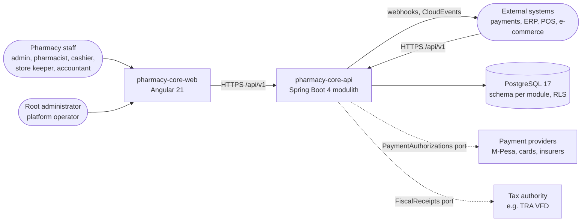
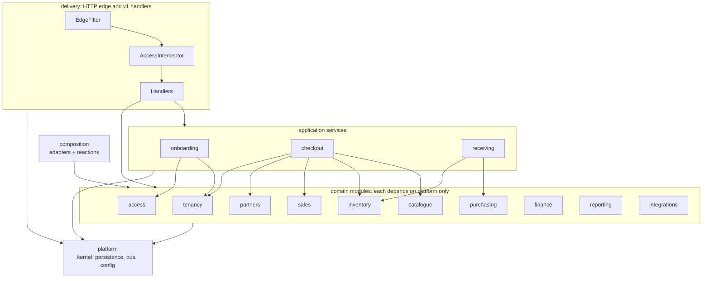
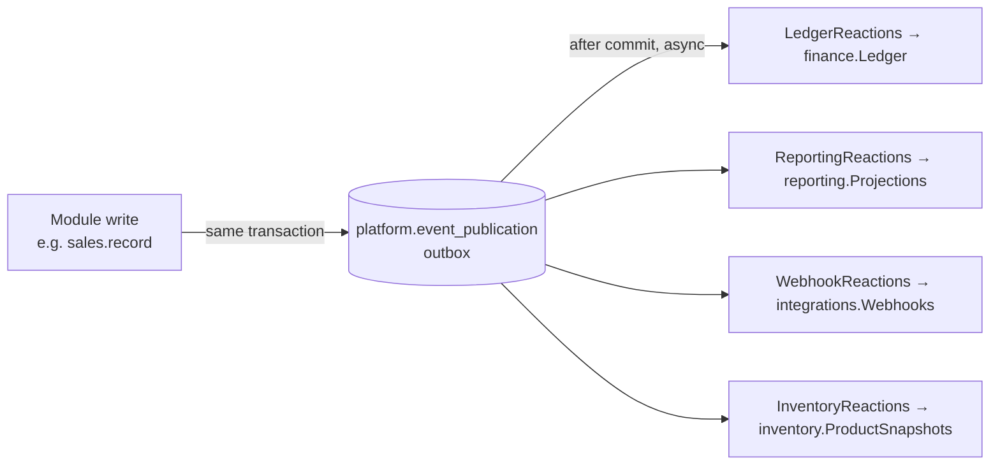

# Architecture overview

Pharmacy Core is one deployable **modular monolith**. The modules have hard boundaries and their own schemas, so one can be split out into a service later without rewriting it. Multi-tenancy is enforced in PostgreSQL itself with row-level security.

## 1. Context



## 2. Containers

| Container | Technology | Notes |
|---|---|---|
| Web app | Angular 21 SPA | Talks only to `/api/v1`. Sends `Authorization`, `X-Tenant-Id` and `X-Branch-Id` |
| API | Java 21, Spring Boot 4.1, Spring Modulith 2.1 | Stateless, so any number of instances can run behind a load balancer. Uses virtual threads |
| Database | PostgreSQL 17 | One schema per module plus `platform`. Forced RLS on every tenant table. Two roles: owner and app |

## 3. Module map



Dependency rules, enforced by Maven, Spring Modulith `verify()` and ArchUnit:

| From | May use |
|---|---|
| Domain module | `platform` only (its jar has no other dependency) |
| Application service | `platform` and modules' `ports.inbound` |
| Delivery | `platform`, modules' `ports.inbound`, application services |
| Composition | Everything's `ports.inbound`, `ports.outbound` and `events` |
| Platform | Nothing above it |

Each module exposes three named interfaces:
- `ports.inbound`: services, commands and views;
- `ports.outbound`: what it needs, implemented in composition;
- `events`: past-tense facts.

Its `domain`, `persistence` and `application` packages are internal.

## 4. Request lifecycle

```mermaid
sequenceDiagram
  participant C as Client
  participant E as EdgeFilter
  participant A as AccessInterceptor
  participant H as Handler
  participant S as Module service
  participant T as TenantAwareTransactionManager
  participant P as PostgreSQL
  C->>E: request + Bearer, X-Tenant-Id, X-Branch-Id
  E->>E: correlation id; authenticate session
  E->>E: tenant exists? membership active? branch allowed?
  E->>E: set ExecutionContext + TenantContext
  E->>A: continue
  A->>A: @Access scope + permission (fail closed)
  A->>H: continue
  H->>S: ports.inbound call
  S->>T: @Transactional begin
  T->>P: set_config('pharmacy.tenant_uid', …, true)
  S->>P: queries (RLS: tenant_uid = current_tenant_uid())
  S-->>H: view
  H-->>C: { success, code, message, data } or RFC 9457 problem
```

## 5. Events and cross-module reactions



- Events are published inside the writing transaction. A rolled-back write publishes nothing.
- Listeners run after commit on their own virtual threads. `EventScopes.run` sets the event's tenant before any transaction starts.
- Delivery is at least once: an incomplete publication is redelivered on restart. Consumers are idempotent: ledger postings are unique per `(source_type, source_uid)`, and reporting records every `event_id` it has processed.
- Ledger postings, reporting figures and webhooks are eventually consistent, normally within milliseconds.

| Event | Published by | Consumed by |
|---|---|---|
| `tenant.registered` | tenancy | integrations |
| `product.changed` | catalogue | inventory (snapshot), integrations |
| `goods.received` | purchasing | finance, reporting, integrations |
| `stock.adjusted`, `stock.low` | inventory | integrations |
| `sale.completed`, `sale.returned` | sales | finance, reporting, integrations |
| `expense.recorded` | finance | reporting |

## 6. Tenancy, branches and the root administrator

| Concept | Where | Enforcement |
|---|---|---|
| Tenant (pharmacy business) | `tenancy.tenants`: a registry with no RLS | Every tenant-owned row has `tenant_uid`, with a forced RLS policy against `platform.current_tenant_uid()`. With no tenant set, the table looks empty |
| Branch | `tenancy.branches`. Branch data carries `branch_uid` | The edge checks `X-Branch-Id` against the membership (`allBranches` or `branchUids`) before the handler runs |
| User | `access.users`: platform scope | One identity, with memberships in any number of tenants |
| Membership | `access.memberships`: RLS where `tenant_uid = current tenant OR user_uid = current user` | Gives a role (a permission set) and branch access per tenant |
| Root administrator | `access.users.root_admin = true` | Uses `/platform/*` routes. May name any tenant and branch, and holds every permission. Every action is recorded under their own identity |

The application connects as `pharmacy_app`, which is `nosuperuser nobypassrls` and owns nothing. The API refuses to start if its role could bypass RLS or owns the schemas.

## 7. Scalability path

| Stage | Change | Code impact |
|---|---|---|
| Now | Stateless API nodes behind a load balancer. Virtual threads. Hikari pool. Keyset paging on UUIDv7. Dashboards read pre-aggregated reporting read models | — |
| Growth | PostgreSQL read replicas for reports. Monthly partitions of `inventory.movements`, `sales.*` and `finance.journal_*`. A cache for the catalogue and settings | Configuration and migrations only |
| Large | Shard tenants across database clusters by `tenant_uid`, with a tenant directory for routing. Move large chains to dedicated databases | Routing data source only. Queries are already tenant-scoped |
| Very large | Extract a hot module (e.g. reporting or integrations) into its own service. Its schema, ports and events already have the right boundaries | Replace in-process ports with HTTP or messaging adapters in composition |

## 8. Security notes

- **Passwords and sessions.** Passwords are hashed with Argon2id. Sessions are opaque random tokens stored only as SHA-256 hashes, so they are revocable on sign-out.
- **Access control.** Every handler declares `@Access`. A handler without it is refused, and an ArchUnit rule checks this too.
- **Isolation.** Tenant isolation is enforced twice, by the application context and by the database (RLS).
- **Data integrity.** Append-only tables (stock movements, journal) have no update grant and carry a `refuse_change` trigger.
- **Error responses.** Errors are RFC 9457 problems with stable reasons and a correlation id, never stack traces.
- **Webhooks.** They are signed with HMAC-SHA256, and only HTTPS targets are allowed (plus localhost for development).
